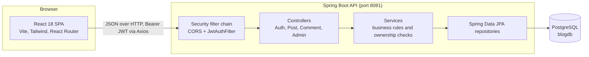
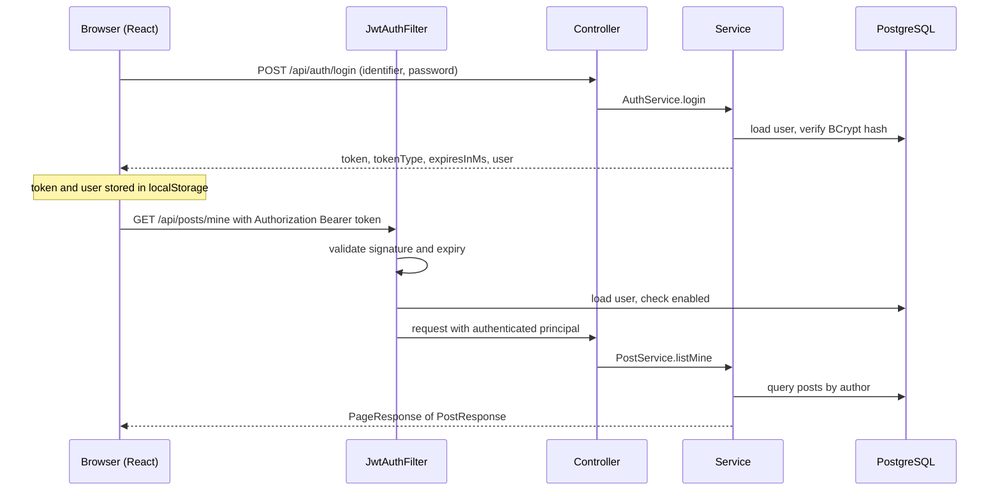
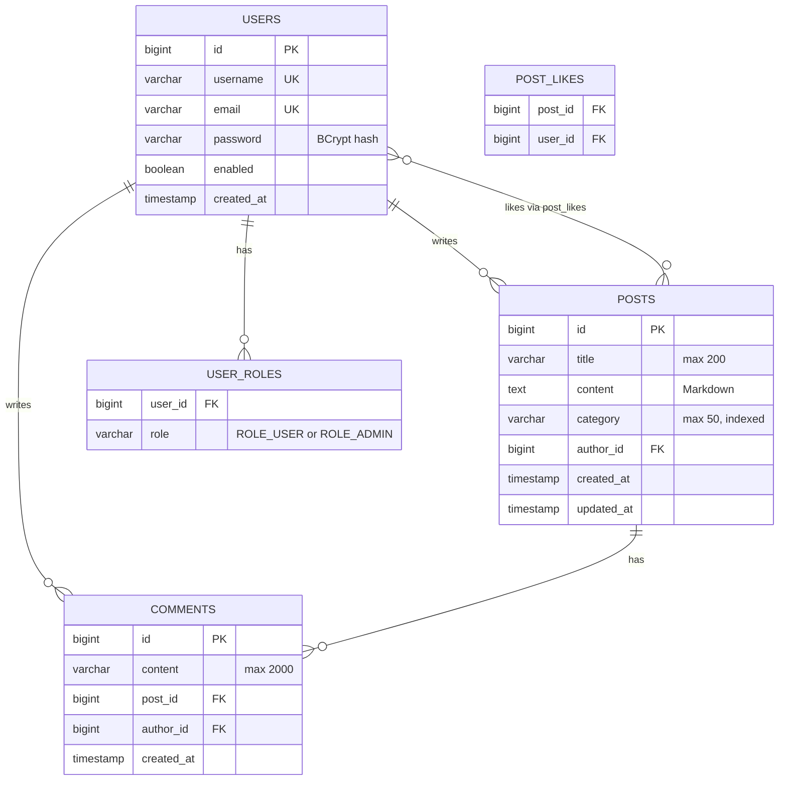

# DraftSpace

> A full-stack blogging platform for long-form writing: a **Spring Boot** REST API with JWT authentication, and a **React** single-page app with Markdown editing, comments, likes and an admin moderation console.


## Table of contents

1. [Overview](#1-overview)
2. [Features](#2-features)
3. [Tech stack](#3-tech-stack)
4. [Architecture](#4-architecture)
5. [Project structure](#5-project-structure)
6. [Getting started](#6-getting-started)
7. [Configuration](#7-configuration)
8. [API reference](#8-api-reference)
9. [Frontend routes](#9-frontend-routes)
10. [Docker status](#10-docker-status)
11. [Production checklist](#11-production-checklist)
12. [Known issues and next steps](#12-known-issues-and-next-steps)

---

## 1. Overview

DraftSpace lets people publish Markdown posts, discuss them in comments, like them, and browse by category or full-text search. Site administrators get a dashboard with metrics, user management and content moderation.

The application lives in [`blog-management-system/`](blog-management-system) and is split into two independently runnable parts:

| Part | Path | Role |
|------|------|------|
| Backend | `blog-management-system/backend` | Stateless REST API, business rules, persistence, security |
| Frontend | `blog-management-system/frontend` | React SPA that consumes the API |

## 2. Features

**Readers (no account needed)**
- Paginated home feed (9 posts per page) with category filter and case-insensitive search across titles and post bodies.
- Filters and page number are kept in the URL (`?q=`, `?category=`, `?page=`), so views are shareable.
- Post page with rendered Markdown, estimated read time, like count, comment thread and a copy-link "Share" button.

**Registered users**
- Register and sign in with either **username or email**.
- Write and edit posts in a Markdown editor with a formatting toolbar, Write / Preview tabs and category autocomplete (pick an existing category or type a new one).
- "My posts" dashboard to view, edit and delete your own posts.
- Like / unlike posts (optimistic UI), comment on posts, and delete your own comments.

**Administrators**
- **Overview:** totals for users, posts and comments, admin and disabled-user counts, and a posts-by-category chart.
- **Users:** grant or revoke the admin role, enable or disable accounts (admins cannot change their own role or status).
- **Moderation:** site-wide feed of posts or comments with delete actions.
- Admins can delete any post or comment; only the original author can edit a post.

**Platform**
- JWT authentication (default lifetime 24 h), BCrypt password hashing, role-based access (`ROLE_USER`, `ROLE_ADMIN`).
- Disabled accounts are rejected on their next request.
- Consistent JSON error format and request validation.
- Interactive API docs via Swagger UI / OpenAPI.
- Dark mode (follows the OS preference, toggle persisted in `localStorage`).
- Bootstrap admin account and optional demo posts created on first start.

## 3. Tech stack

| Layer | Technology |
|-------|------------|
| Language / runtime | Java 17 |
| Backend framework | Spring Boot 3.3.4 (Web, Data JPA, Security, Validation) |
| Persistence | Hibernate / JPA, **PostgreSQL** (`org.postgresql` driver). H2 is on the classpath but not wired into the default config |
| Auth | Spring Security (stateless) + JJWT 0.12.6, BCrypt |
| API docs | springdoc-openapi 2.6.0 (Swagger UI) |
| Boilerplate | Lombok, Java records for DTOs |
| Build | Maven (spring-boot-maven-plugin), jar named `app.jar` |
| Frontend | React 18.3, Vite 5, React Router 6, Axios 1.7 |
| Styling / UI | Tailwind CSS 3.4 + `@tailwindcss/typography`, lucide-react icons, Google Fonts (Bricolage Grotesque, Source Serif 4) |
| Markdown | react-markdown 9 |
| Containers | Dockerfiles for both apps, nginx 1.27 for the SPA, `docker-compose.yml` (see [Docker status](#10-docker-status)) |

## 4. Architecture

### 4.1 System overview



A classic three-tier layout: the SPA is a pure client, the API is stateless (no HTTP session; identity travels in the JWT), and PostgreSQL is the single source of truth.

### 4.2 Backend layers

Base package: `com.example.blog`

| Package | Responsibility |
|---------|----------------|
| `controller` | HTTP mapping, request validation (`@Valid`), delegates to services. `AuthController`, `PostController`, `CommentController`, `AdminController` |
| `service` | Business logic, ownership/permission checks, DTO mapping. `AuthService`, `PostService`, `CommentService`, `AdminService` |
| `repository` | Spring Data JPA interfaces with custom JPQL for search, grouped counts and distinct categories |
| `entity` | JPA entities: `User`, `Post`, `Comment`, and the `Role` enum |
| `dto` | Request/response **records** (`PostDtos`, `AuthDtos`, `CommentDtos`, `AdminDtos`, `UserResponse`, generic `PageResponse<T>`) so entities never leak over the wire |
| `security` | `JwtUtils` (sign/verify), `JwtAuthFilter` (per-request auth), `UserDetailsServiceImpl` (login by username or email), `SecurityUtils` |
| `config` | `SecurityConfig` (filter chain, CORS, BCrypt), `OpenApiConfig` (Swagger + bearer scheme), `DataInitializer` (seed admin and demo data) |
| `exception` | `GlobalExceptionHandler` maps exceptions to a uniform `ApiError` body |

Notable design choices:

- **Stateless auth**: CSRF disabled, `SessionCreationPolicy.STATELESS`, `JwtAuthFilter` runs before `UsernamePasswordAuthenticationFilter`.
- **Per-request user lookup**: the filter reloads the user on every request, so disabling an account takes effect immediately.
- **N+1 avoidance**: `@EntityGraph` fetches authors with posts/comments, and comment counts for a page of posts come from one grouped query (`countGroupedByPostIds`).
- **`open-in-view: false`**: all lazy loading happens inside `@Transactional` service methods.
- **Safe pagination**: page size is clamped (posts max 50, admin lists max 100) and sorted by newest first.
- **Computed response fields**: `excerpt` (first ~220 characters of stripped Markdown), `readTimeMinutes` (words / 200, minimum 1), `commentCount`, `likeCount`, `likedByCurrentUser`. List responses omit the full `content`.
- **Method security**: `AdminController` is guarded by `@PreAuthorize("hasRole('ADMIN')")`.

### 4.3 Authentication flow



Axios attaches `Authorization: Bearer <token>` from `localStorage` on every request. Invalid, expired or unknown-user tokens are ignored by the filter, so the request simply continues as anonymous.

**Access rules at a glance**

| Who | Can do |
|-----|--------|
| Anonymous | Read posts, categories and comments; register; log in |
| `ROLE_USER` | Everything above, plus create posts, edit **own** posts, delete own posts/comments, comment, like |
| `ROLE_ADMIN` | Everything a user can, plus delete **any** post/comment and use `/api/admin/**` |

New registrations receive `ROLE_USER`. The bootstrap admin receives both roles, and every account always keeps `ROLE_USER`.

### 4.4 Frontend architecture

- **Entry**: `main.jsx` wraps the app in `BrowserRouter` and `AuthProvider`; `App.jsx` declares routes inside a shared `Layout` (navbar, content area, footer).
- **State**: no external store. `AuthContext` holds the current user (`user`, `isAuthenticated`, `isAdmin`, `login`, `register`, `logout`); page-level data uses local `useState`/`useEffect`.
- **API layer**: `api/client.js` creates the Axios instance (base URL from `VITE_API_URL`, default `http://localhost:8081/api`) and the token interceptor; `api/services.js` groups calls into `authApi`, `postApi`, `commentApi`, `adminApi`.
- **Route guards**: `ProtectedRoute` requires login and optionally a role (`ROLE_ADMIN` for `/admin`).
- **Reusable UI**: `Navbar` (with dark-mode toggle), `PostRow` (post card), `Pagination` (zero-based, matches Spring Data), and small helpers in `ui.jsx` (`Spinner`, `ErrorNote`, `Empty`, `Field`, `RoleBadge`, `formatDate`).
- **Styling**: Tailwind with a custom palette (`ink`, `paper`, `brand`, `danger`, `ok`) and shared component classes (`btn-primary`, `btn-ghost`, `input`, …) in `index.css`. Dark mode uses Tailwind's `class` strategy.
- **Markdown**: post bodies render through `react-markdown`, which does not render raw HTML by default.

### 4.5 Data model



Deleting a post cascades to its comments (`CascadeType.REMOVE`). Users can be disabled but there is no delete-user endpoint. Tables are created and updated by Hibernate (`ddl-auto: update` by default); there are no migration scripts.

## 5. Project structure

```
DraftSpace/
├── README.md                          # this file
├── .idea/                             # IntelliJ project metadata
└── blog-management-system/
    ├── README.md                      # older notes (partly outdated, see section 12)
    ├── docker-compose.yml
    ├── .env.example
    │
    ├── backend/                       # Spring Boot API
    │   ├── pom.xml
    │   ├── Dockerfile                 # multi-stage: Maven build, then JRE 17 runtime
    │   └── src/main/
    │       ├── resources/application.yml
    │       └── java/com/example/blog/
    │           ├── BlogApplication.java
    │           ├── config/            # SecurityConfig, OpenApiConfig, DataInitializer
    │           ├── controller/        # Auth, Post, Comment, Admin controllers
    │           ├── service/           # Auth, Post, Comment, Admin services
    │           ├── repository/        # User, Post, Comment repositories
    │           ├── entity/            # User, Post, Comment, Role
    │           ├── dto/               # request/response records
    │           ├── security/          # JwtUtils, JwtAuthFilter, UserDetailsServiceImpl, SecurityUtils
    │           └── exception/         # GlobalExceptionHandler, ApiError, custom exceptions
    │
    └── frontend/                      # React SPA
        ├── package.json
        ├── vite.config.js             # dev server on 5173 (+ optional /api proxy)
        ├── tailwind.config.js         # palette, fonts, typography, dark mode
        ├── Dockerfile                 # multi-stage: Node build, then nginx
        ├── nginx.conf                 # SPA fallback, /api proxy, asset caching
        ├── .env.example
        └── src/
            ├── main.jsx, App.jsx, index.css
            ├── api/                   # client.js (Axios), services.js (API calls)
            ├── context/               # AuthContext.jsx
            ├── components/            # Navbar, PostRow, Pagination, ProtectedRoute, ui
            └── pages/                 # Home, PostView, PostEditor, MyPosts, Login, Register, NotFound
                └── admin/             # AdminDashboard, Overview, UsersTab, ModerationTab
```

## 6. Getting started

### Prerequisites

- JDK 17 or newer
- Maven 3.9+
- Node.js 20+ and npm
- A running PostgreSQL server

### 1. Get the code

```bash
git clone https://github.com/udaykesarkar27-rgb/DraftSpace.git
cd DraftSpace/blog-management-system
```

### 2. Create the database

```sql
CREATE DATABASE blogdb;
```

Tables are created automatically on first start.

### 3. Run the backend

Spring Boot does **not** read `.env` files by itself, so export the variables in your shell (or set them in your IDE run configuration):

```bash
cd backend

export DB_URL=jdbc:postgresql://localhost:5432/blogdb
export DB_USERNAME=postgres
export DB_PASSWORD=<your-postgres-password>
export JWT_SECRET=<random-string-of-at-least-32-characters>

mvn spring-boot:run
```

On Windows PowerShell use `$env:DB_PASSWORD = "..."` instead of `export`.

The API starts on **http://localhost:8081**. Every variable has a development default in `application.yml`, but you should set at least `DB_PASSWORD` and `JWT_SECRET` yourself (see [Configuration](#7-configuration)).

### 4. Run the frontend

```bash
cd frontend
npm install
npm run dev
```

Open **http://localhost:5173**. The frontend calls `http://localhost:8081/api` by default; set `VITE_API_URL` (for example in `frontend/.env`) if your API runs elsewhere. The backend allows requests from `http://localhost:5173` and `http://localhost:3000` out of the box.

### 5. Sign in

On first start the backend creates an admin account and, if `SEED_DEMO_DATA=true` and no posts exist yet, two demo posts.

| Field | Default |
|-------|---------|
| Username | `admin` |
| Password | `Admin@12345` |

Override with `ADMIN_USERNAME`, `ADMIN_EMAIL` and `ADMIN_PASSWORD`, and **change the password before any real deployment**. The admin is only created if no user with that username exists.

### API documentation

With the backend running, open Swagger UI at **http://localhost:8081/swagger-ui/index.html** (raw spec at `/v3/api-docs`). Call `POST /api/auth/login`, click **Authorize**, and paste the returned token to try protected endpoints.

### Build for production

```bash
# backend: produces backend/target/app.jar
cd backend && mvn clean package -DskipTests
java -jar target/app.jar

# frontend: produces frontend/dist/ (static files)
cd frontend && npm run build
```

## 7. Configuration

### Backend (environment variables read by `application.yml`)

| Variable | Purpose | Default |
|----------|---------|---------|
| `DB_URL` | JDBC URL | `jdbc:postgresql://localhost:5432/blogdb` |
| `DB_USERNAME` | Database user | `postgres` |
| `DB_PASSWORD` | Database password | development default in `application.yml`; always override |
| `DDL_AUTO` | Hibernate schema mode | `update` |
| `JWT_SECRET` | HMAC signing key, **at least 32 bytes** or the app refuses to start | insecure placeholder; always override |
| `JWT_EXPIRATION_MS` | Token lifetime in milliseconds | `86400000` (24 h) |
| `CORS_ALLOWED_ORIGINS` | Comma-separated allowed origins | `http://localhost:5173,http://localhost:3000` |
| `ADMIN_USERNAME` | Bootstrap admin username | `admin` |
| `ADMIN_EMAIL` | Bootstrap admin email | `admin@blog.local` |
| `ADMIN_PASSWORD` | Bootstrap admin password | `Admin@12345` |
| `SEED_DEMO_DATA` | Create demo posts when the table is empty | `true` |

The HTTP port is set in `application.yml` (`server.port: 8081`). As with any Spring Boot property it can be overridden with the `SERVER_PORT` environment variable.

### Frontend (Vite, read at build/dev time)

| Variable | Purpose | Default |
|----------|---------|---------|
| `VITE_API_URL` | API base URL used by Axios | `http://localhost:8081/api` |
| `VITE_PROXY_TARGET` | Target of the optional Vite dev proxy for `/api` | `http://localhost:8080` |

Note: because Axios uses an absolute base URL by default, the Vite dev proxy is not used unless you set `VITE_API_URL=/api` (and point `VITE_PROXY_TARGET` at the API).

## 8. API reference

Base path: `/api`. Interactive docs: Swagger UI (see above). "Auth" means a valid `Authorization: Bearer <token>` header.

### Auth

| Method | Path | Access | Notes |
|--------|------|--------|-------|
| POST | `/auth/register` | Public | Returns `201` with token and user |
| POST | `/auth/login` | Public | Body: `{ identifier, password }`; `identifier` is username or email |
| GET | `/auth/me` | Auth | Current user |

### Posts

| Method | Path | Access | Notes |
|--------|------|--------|-------|
| GET | `/posts?page&size&category&search` | Public | Defaults: page 0, size 9 (max 50), newest first |
| GET | `/posts/categories` | Public | Distinct category names |
| GET | `/posts/mine?page&size` | Auth | Your posts, default size 10 |
| GET | `/posts/{id}` | Public | Includes full Markdown `content` |
| POST | `/posts` | Auth | Returns `201` |
| PUT | `/posts/{id}` | Author only | |
| DELETE | `/posts/{id}` | Author or admin | Returns `204`; also deletes comments |
| POST | `/posts/{id}/like` | Auth | Toggles like/unlike, returns `204` |

### Comments

| Method | Path | Access | Notes |
|--------|------|--------|-------|
| GET | `/posts/{postId}/comments` | Public | Oldest first |
| POST | `/posts/{postId}/comments` | Auth | Returns `201` |
| DELETE | `/comments/{id}` | Author or admin | Returns `204` |

### Admin (`ROLE_ADMIN` only)

| Method | Path | Notes |
|--------|------|-------|
| GET | `/admin/metrics` | Totals, admin/disabled counts, posts per category |
| GET | `/admin/users?page&size` | Default size 10, max 100 |
| PUT | `/admin/users/{id}/roles` | Body: `{ roles: [...] }`; `ROLE_USER` is always kept; cannot change your own roles |
| PATCH | `/admin/users/{id}/enabled` | Body: `{ enabled }`; cannot disable yourself |
| GET | `/admin/comments?page&size` | Newest first |

### Validation rules

| Field | Rule |
|-------|------|
| `username` | 3-50 chars; letters, digits, `.`, `_`, `-` |
| `email` | valid email, max 120 |
| `password` | 6-100 chars |
| Post `title` / `category` / `content` | required; max 200 / 50 / 50,000 chars |
| Comment `content` | required; max 2,000 chars |

### Paged responses

```json
{ "content": [], "page": 0, "size": 9, "totalElements": 0, "totalPages": 0, "last": true }
```

### Error format

All handled errors share one shape (`fieldErrors` appears only for validation failures):

```json
{
  "timestamp": "2026-01-01T10:00:00Z",
  "status": 400,
  "error": "Bad Request",
  "message": "Validation failed",
  "path": "/api/posts",
  "fieldErrors": { "title": "must not be blank" }
}
```

| Status | When |
|--------|------|
| 400 | Validation failure, malformed JSON, bad parameter, rule violation (for example changing your own role) |
| 401 | Wrong credentials, or an unauthenticated call to a post-write endpoint |
| 403 | Disabled account, or not allowed to perform the action |
| 404 | Resource not found |
| 409 | Username or email already taken, or a data-integrity conflict |
| 500 | Unexpected error (details are logged, not returned) |

## 9. Frontend routes

| Path | Page | Access |
|------|------|--------|
| `/` | Home feed with search, category filter, pagination | Public |
| `/posts/:id` | Post, likes, share, comments | Public |
| `/login`, `/register` | Authentication | Public |
| `/dashboard` | My posts | Logged in |
| `/dashboard/new` | Create post | Logged in |
| `/dashboard/edit/:id` | Edit post | Logged in (author) |
| `/admin` | Overview, Users, Moderation tabs | `ROLE_ADMIN` |
| `*` | Not found | Public |

## 10. Docker status

The repository contains Dockerfiles for both apps and a `docker-compose.yml`, but by reading the files they are **out of sync with the current backend** and will not produce a working stack as committed:

| Area | Compose / Docker says | Backend code actually uses |
|------|-----------------------|----------------------------|
| Database | MySQL 8 service, `jdbc:mysql://...` URL | PostgreSQL driver and dialect (`pom.xml`, `application.yml`); no MySQL driver is included |
| API port | Publishes `8080`; nginx proxies to `backend:8080`; Dockerfile `EXPOSE 8080` | `server.port: 8081` |
| Frontend API URL | nginx proxies `/api/` to the backend | Axios defaults to the absolute URL `http://localhost:8081/api`, bypassing nginx unless `VITE_API_URL=/api` is set at build time |

To containerise the current code, the compose file needs a PostgreSQL service (with matching `DB_URL`, `DB_USERNAME`, `DB_PASSWORD`), `SERVER_PORT=8080` on the backend (or 8081 everywhere), and `VITE_API_URL=/api` passed as a build argument to the frontend image. Until then, use the local setup in [Getting started](#6-getting-started).

## 11. Production checklist

- [ ] Set a strong, unique `JWT_SECRET` (32+ characters) and keep it out of version control.
- [ ] Change the bootstrap admin credentials (or remove the default admin after creating your own).
- [ ] Set `DB_PASSWORD` explicitly; never rely on the defaults in `application.yml`.
- [ ] Set `SEED_DEMO_DATA=false`.
- [ ] Switch `DDL_AUTO` to `validate` and manage schema changes with Flyway or Liquibase.
- [ ] Restrict `CORS_ALLOWED_ORIGINS` to your real frontend origin(s).
- [ ] Serve everything over HTTPS (TLS-terminating proxy in front of the app).
- [ ] Be aware the JWT is stored in `localStorage`: keep post rendering Markdown-only (no raw HTML) to limit XSS exposure.
- [ ] Never commit real secrets. `.env` is git-ignored; keep `.env.example` to placeholders only.

## 12. Known issues and next steps

Found while reading the code; none of these were exercised by running the app.

1. **Docker setup is stale**: see [Docker status](#10-docker-status).
2. **Older README is partly wrong**: `blog-management-system/README.md` still describes MySQL, port 8080 and an H2 in-memory mode that the default configuration doesn't provide. This file supersedes it.
3. **No automated tests**: `src/test` does not exist, although `spring-boot-starter-test` and `spring-security-test` are already in `pom.xml`. A good first step is integration tests for auth, post ownership rules and admin endpoints.
4. **Route security is split between the filter chain and controllers**: `/api/posts/**` is `permitAll` in `SecurityConfig`, so write endpoints such as `POST /api/posts/{id}/comments` depend on controller-level checks. `PostController` checks authentication explicitly, while `CommentController.add` uses the `Authentication` argument directly, so an unauthenticated call there will likely return `500` instead of `401`. Restricting by HTTP method in the filter chain (`GET` public, everything else authenticated) would make this robust.
5. **Swagger URL**: the `permitAll` matcher covers `/swagger-ui/**` but not `/swagger-ui.html`. If `/swagger-ui.html` returns `403`, use `/swagger-ui/index.html`.
6. **No custom 401 entry point**: `SecurityConfig` contains a `writeError` helper that is never used, so unauthenticated requests to protected routes get Spring Security's default response rather than the standard `ApiError` JSON.
7. **Client-side session expiry**: `AuthContext` listens for an `auth:logout` event, but nothing dispatches it (the Axios instance has no response interceptor). An expired token is therefore not detected until the user logs out manually.
8. **Debug logging in the browser**: the Axios request interceptor logs to the console on every request; remove before production.

## License

No license file has been added yet. Add a `LICENSE` to define how others may use this code.

---

Maintained by [@udaykesarkar27-rgb](https://github.com/udaykesarkar27-rgb).
